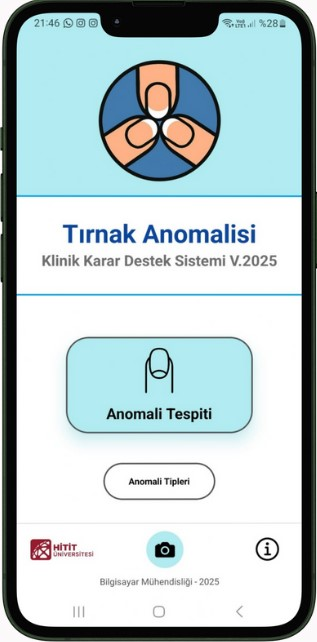
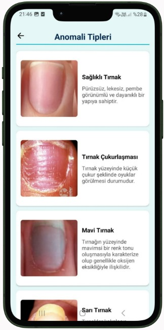

# Tırnak Anomali Mobil Uygulaması

Tırnak Anomalisine Dayalı Hastalık Teşhis Sistemi, tırnak görüntülerini analiz için bir tahmin servisine ileten ve elde edilen sınıfı açıklayıcı içerikle eşleştiren React Native mobil uygulamasıdır. Bu depo; mobil istemciyi, anomali ve hastalık verilerini, Firestore yükleme betiklerini ve uygulama görsellerini içerir.

> Uygulama bir karar destek ve bilgilendirme aracıdır. Sonuçlar tıbbi tanı yerine geçmez; sağlıkla ilgili değerlendirme için bir sağlık uzmanına başvurulmalıdır.

## Uygulama akışı

1. Kullanıcı ana ekrandan kamerayı açar ya da galeriden bir tırnak fotoğrafı seçer.
2. Kamera ile çekilen görüntünün odak alanı kare olarak kırpılır.
3. Görüntü, mobil istemcide tanımlı tahmin servisine `image` alanıyla gönderilir.
4. Servisin `predictions` yanıtındaki ilk sınıf, Firestore'daki anomali kaydıyla eşleştirilir.
5. Sonuç ekranında anomali açıklaması ve varsa ilişkili hastalıklar gösterilir. Anomali kataloğundan da ayrıntı ve bilgi bağlantıları açılabilir.

## Ekran görüntüleri

| Ana ekran | Anomali kataloğu | Analiz sonucu |
| --- | --- | --- |
|  |  |  |

## Proje içeriği

- **Mobil istemci:** React Native ve Expo; ekran geçişleri React Navigation ile yapılır.
- **Kamera ve görsel seçimi:** `expo-camera`, `expo-image-picker` ve `expo-image-manipulator`.
- **Tahmin isteği:** Axios ile görsel yükleme; arayüz `predictions` içindeki `class_name` alanını kullanır.
- **Anomali ve hastalık bilgileri:** Firebase Firestore üzerinden `Anomalies`, `Diseases` ve `anomalyDiseases` koleksiyonlarından okunur.
- **JSON veri dosyaları:** `anomalies.json`, `diseases.json` ve `anomalyDiseases.json` Firestore'a aktarılabilecek kayıtları içerir. Mevcut dosyalarda 12 anomali kataloğu kaydı (sağlıklı tırnak örneği dahil), 44 hastalık kaydı ve 51 ilişki kaydı bulunur.
- **Yükleme betikleri:** `upload.js`, `upload_diseases.js` ve `upload_ad.js`, JSON verilerini Firestore'a aktarmak için kullanılır. Bu betikler Firebase Admin servis hesabı kimlik bilgisi gerektirir.

## Kullanılan başlıca teknolojiler

| Alan | Teknolojiler |
| --- | --- |
| Mobil | React Native, Expo |
| Gezinme | React Navigation |
| Kamera ve görsel işleme | Expo Camera, Image Picker, Image Manipulator |
| Veri ve bulut | Firebase Firestore |
| API iletişimi | Axios |
| Animasyon | Lottie |

## Model Performansı

- Genel doğruluk: %92–93
- Ortalama F1 skoru: 0,87
- 11 tırnak anomalisini sınıflandırır.
- Örnek sınıflar: Clubbing (çomak parmak), Melanonychia (melanonişi), Leukonychia (lökonişi) ve Yellow Nail Syndrome (sarı tırnak sendromu).

## Yerel çalıştırma

Node.js ve npm kurulu olmalıdır.

```bash
npm install
npm start
```

Expo CLI açıldıktan sonra uygulamayı kullanılabilir bir emülatör veya cihazda başlatın. Android yerel çalıştırma için `npm run android` komutu da tanımlıdır.

Görsel tahmini için erişilebilir bir `/predict` servisi ve uygulamayla aynı Firebase projesine ait Firestore yapılandırması gerekir. API adresi istemci kodunda tanımlıdır; farklı bir servis kullanırken `screens/HomeScreen.js` ve `screens/CameraScreen.js` içindeki adresi güncelleyin. Yönetici yükleme betiklerinin gerektirdiği servis hesabı anahtarını depoya eklemeyin.

## Dizin yapısı

```text
screens/                 Mobil uygulama ekranları
assets/                  Logo, ikon ve yükleme animasyonu
images/                  README'de kullanılan uygulama ekran görüntüleri
anomalies.json           Anomali kataloğu verileri
diseases.json            Hastalık verileri
anomalyDiseases.json     Anomali-hastalık ilişkileri
upload*.js               Firestore veri yükleme betikleri
```
